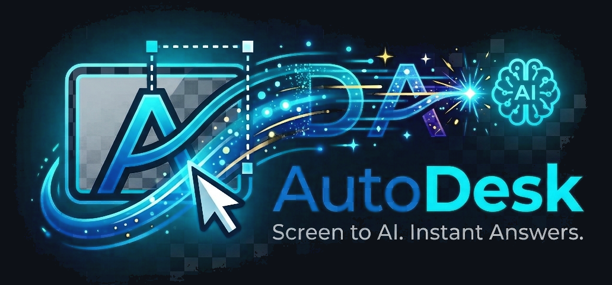
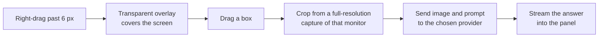
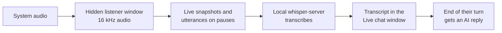

<div align="center">



### Right-click and drag over anything. Get an answer right where you are looking.

[](https://github.com/NarihitoM/AutoDesk/actions/workflows/ci.yml)


[](https://github.com/NarihitoM/AutoDesk/releases/latest)

[Features](#features) &nbsp;&bull;&nbsp; [Install](#install) &nbsp;&bull;&nbsp; [Getting started](#getting-started) &nbsp;&bull;&nbsp; [Privacy](#privacy) &nbsp;&bull;&nbsp; [Development](#development)

</div>

<br />

AutoDesk is a lightweight Windows tray app that turns any part of your screen into an AI prompt. Point it at an error message, a chart, a math problem, a form, or a page in another language. Drag a box over it, let go, and the answer streams into a small panel right next to your selection. No copying, no pasting, no switching windows.

## Features

<table>
  <tr>
    <td width="50%" valign="top">
      <h4>Right-click and drag to capture</h4>
      Hold the right mouse button, drag a box, and let go. That is the whole workflow. No screenshot tool, no file to save, no window to switch to.
    </td>
    <td width="50%" valign="top">
      <h4>Your right-click keeps working</h4>
      A quick right-click still opens menus as usual. Only a right-drag starts a capture, and you can switch to Alt, Ctrl, or Shift + drag instead.
    </td>
  </tr>
  <tr>
    <td width="50%" valign="top">
      <h4>Answers next to what you selected</h4>
      Replies stream in as they are written, with Markdown formatting and code blocks. Ask follow-up questions about the same capture.
    </td>
    <td width="50%" valign="top">
      <h4>Your choice of AI</h4>
      OpenAI, Claude, Gemini, Groq, OpenRouter, or a free local model through Ollama or LM Studio. Every model loads live from the provider, and models that cannot read images still work through an image reader.
    </td>
  </tr>
  <tr>
    <td width="50%" valign="top">
      <h4>Sharp on any screen</h4>
      Works across multiple monitors and high-DPI displays, and captures at full resolution.
    </td>
    <td width="50%" valign="top">
      <h4>Private by design</h4>
      No AutoDesk server, no account. Your API keys are encrypted on your PC, and images go straight to the provider you chose.
    </td>
  </tr>
  <tr>
    <td width="50%" valign="top">
      <h4>Live assist for calls</h4>
      Transcribes a call or interview word by word as people speak, and the AI replies in a chat each time they finish talking.
    </td>
    <td width="50%" valign="top">
      <h4>Speech stays on your PC</h4>
      A small speech-to-text model ships inside the installer and runs offline. Only the transcript text goes to the AI.
    </td>
  </tr>
</table>

## Install

1. Download **[`AutoDesk.exe`](https://github.com/NarihitoM/AutoDesk/releases/latest/download/AutoDesk.exe)** from the [latest release](https://github.com/NarihitoM/AutoDesk/releases/latest).
2. Run it. Choose whether to install for just you or for everyone on the PC, then pick the install folder (or keep the default) and click **Install**.
3. AutoDesk starts in the system tray when setup finishes. The Settings window opens the first time so you can add a key.

The speech engine and model for Live assist are included in the installer, so there is nothing else to download.

> [!NOTE]
> The installer is not code-signed yet, so Windows SmartScreen may show a warning. Click **More info**, then **Run anyway**.

## Getting started

**1. Connect an AI provider**

| Provider | Where to get a key | Needs a key |
| --- | --- | :---: |
| OpenAI | [platform.openai.com/api-keys](https://platform.openai.com/api-keys) | Yes |
| Anthropic Claude | [console.anthropic.com/settings/keys](https://console.anthropic.com/settings/keys) | Yes |
| Google Gemini | [aistudio.google.com/apikey](https://aistudio.google.com/apikey) | Yes |
| Groq | [console.groq.com/keys](https://console.groq.com/keys) | Yes |
| OpenRouter | [openrouter.ai/keys](https://openrouter.ai/keys) | Yes |
| Ollama (local, free) | Install [Ollama](https://ollama.com), then run `ollama pull llava` | No |
| LM Studio (local, free) | Install [LM Studio](https://lmstudio.ai), load a vision model, and start the local server | No |
| Custom | Any server with an OpenAI-compatible API | Optional |

Open **Settings** from the tray icon, pick the provider, paste the key, and choose a model. A green dot on a provider means its key is saved or, for Ollama, LM Studio, and Custom, that AutoDesk reached the server and found models. The model list is fetched live from the provider, and models that can read screenshots are tagged **Images**. Click **Save** when you are done.

**2. Capture**

Hold the **right mouse button**, drag over part of your screen, and let go. The answer appears in a panel next to your selection.

### Controls

| Action | How |
| --- | --- |
| Capture an area | Hold the right mouse button and drag |
| Open a normal context menu | Right-click without dragging |
| Cancel a capture | <kbd>Esc</kbd> while dragging, or drag a box smaller than 32 px. Small boxes are never sent. |
| Ask a follow-up | Type in the panel and press <kbd>Enter</kbd> (<kbd>Shift</kbd>+<kbd>Enter</kbd> adds a new line) |
| Stop a reply | Click **Stop** |
| Close the panel | <kbd>Esc</kbd> or **Close** |
| Pause, Live assist, Settings, Quit | Right-click the tray icon |

### Live assist

Live assist listens to your computer's audio, such as a call, meeting, interview, or video, streams the transcript into a chat as it is spoken, and the AI replies like a chatbot. Your microphone is never used.

1. Open the **Live assist** tab in the AutoDesk window. Right-click the tray icon and choose **Live assist** to jump straight to it.
2. Click **Start**. Unsaved changes are saved, the **Live chat** window opens, and transcription begins. The first start takes a few seconds while the speech engine loads.
3. Words from the system audio appear on the right as **You** while they are spoken. Everything said stays in one message until the audio is quiet for about two seconds.
4. When the audio pauses, the whole message is sent to the AI, and its reply streams in on the left as **AI**. Press <kbd>Ctrl</kbd>+<kbd>Shift</kbd>+<kbd>Space</kbd> to get a reply right away.
5. Click **Stop** in the chat or on the Live assist tab to stop listening. Stopping clears the chat and the history the AI sees, so the next start begins fresh. Closing the chat window also stops it.

Speech recognition uses [whisper.cpp](https://github.com/ggml-org/whisper.cpp) with the `base` model (about 60 MB). It is included in the installer, so there is nothing extra to download, and it runs entirely on your PC. Replies use the AI provider and model from Settings.

### Settings

| Setting | What it does |
| --- | --- |
| AI provider | Which service answers your captures |
| API key | Your key for that provider. Optional for local servers. |
| Model | A dropdown of every model the provider offers, tagged **Images** or **Text only**. It stays empty until the provider is connected. |
| Image reader | Shown when the chosen model cannot read images. This model describes the screenshot, and your chosen model answers from that description. **Automatic** picks the first model tagged Images and is used only when needed. Pick a specific model to always use it for models not tagged Images. |
| Reasoning | For thinking models: **Default** leaves it to the model, **Off** answers fastest, and **Low**, **Medium**, or **High** think longer on hard questions. Saved per provider, and used for captures, the image reader, and Live assist. Ollama starts at Off. |
| Base URL | Change only for a proxy or a self-hosted server |
| Capture key | Right mouse button (default), or hold <kbd>Alt</kbd>, <kbd>Ctrl</kbd>, or <kbd>Shift</kbd> and left-drag |
| Prompt | The instruction sent with every capture |
| Appearance | Match Windows, Light, or Dark |
| Start with Windows | Launch AutoDesk when you sign in |

The **Live assist** tab has its own options: spoken language, automatic replies, and the instructions for AI replies.

<details>
<summary><b>Default endpoints</b></summary>
<br />

| Provider | Base URL |
| --- | --- |
| OpenAI | `https://api.openai.com/v1` |
| Anthropic | `https://api.anthropic.com` |
| Gemini | `https://generativelanguage.googleapis.com` |
| Groq | `https://api.groq.com/openai/v1` |
| OpenRouter | `https://openrouter.ai/api/v1` |
| Ollama | `http://localhost:11434/v1` |
| LM Studio | `http://localhost:1234/v1` |
| Custom | `http://localhost:8000/v1` |

No model is preselected. Pick one from the live list after connecting.

</details>

<details>
<summary><b>How AutoDesk knows which models read images</b></summary>
<br />

| Provider | Source of the list | How image support is detected |
| --- | --- | --- |
| Anthropic | Models API | The `image_input` capability reported for each model |
| OpenRouter | Models API | The model's `input_modalities` include `image` |
| Ollama | `/api/tags` and `/api/show` | The model's capabilities include `vision` |
| LM Studio | `/api/v0/models` | The model type is `vlm` |
| OpenAI, Gemini | Models API | Matched by model family, since these APIs do not report image support |
| Groq, Custom | `/models` | Matched by model name. Others are left untagged. |


When the chosen model cannot read images, AutoDesk sends the screenshot to the image reader first and passes its description to your model. If image support is unknown, AutoDesk sends the screenshot directly and falls back to the image reader only if the provider rejects it. Follow-up questions reuse the same description.

</details>

## Privacy

- A screenshot is taken only when you finish a drag, and only of the area you selected.
- The image and your questions go directly from your PC to the provider you chose. There is no AutoDesk server in between.
- Everything is stored locally in a `.autodesk` folder in your user profile, created the first time you open the app:

  ```
  C:\Users\<you>\.autodesk\
    settings.json       provider, models, prompt, capture key
    credentials.json    API keys, encrypted for your Windows account
  ```

- Live assist records audio only while it is started. Audio is transcribed on your PC and is never saved or uploaded. The transcript text is sent to your provider to generate replies.
- API keys are encrypted with Windows' built-in data protection, so the file cannot be read on another PC or by another Windows user. If you paste a plain key into `credentials.json` by hand, AutoDesk encrypts it the next time it starts.
- Click **Open folder** in Settings to jump to this folder.

## Development

**Requirements:** Windows 10 or 11, Node.js 22.12 or newer.

```bash
npm install
npm run dev          # run the app with hot reload
npm test             # unit tests
npm run test:watch   # unit tests in watch mode
npm run typecheck    # TypeScript checks
npm run fetch:speech # download the speech engine and model into resources/speech
npm run dist         # download speech files, then build the installer into dist/
```

`npm run dev` needs the speech files for Live assist, so run `npm run fetch:speech` once after cloning. The script downloads a pinned whisper.cpp release and models, checks each file's SHA-256, and skips files that are already up to date. The files are git-ignored and bundled into the installer by `npm run dist`.

**Tech stack:** Electron, React, TypeScript, Vite (electron-vite), Tailwind CSS, Zustand, `uiohook-napi` to detect the capture key globally, `koffi` for the Windows mouse hook behind right-drag capture, and whisper.cpp for offline speech-to-text.

<details>
<summary><b>How capture works</b></summary>
<br />



1. A low-level Windows mouse hook, running on its own thread, holds back the right button press. If you release without moving, it replays a normal right-click, so context menus still open. If you move more than 6 px, a capture starts and the app underneath never sees the click.
2. A transparent overlay window covers the screen under the cursor and draws the selection as you drag.
3. With Alt, Ctrl, or Shift as the capture key, a global keyboard hook arms the overlay after the key is held on its own for 150 ms, and you left-drag on the overlay instead.
4. On release, the selected area is cropped from a full-resolution capture of that monitor. The overlay is excluded from the capture.
5. The image is sent with your prompt to the provider, and the reply streams into the panel.

</details>

<details>
<summary><b>How Live assist works</b></summary>
<br />



1. A hidden window captures system audio through Windows loopback. It has no microphone permission.
2. The audio is split into utterances on pauses, with a noise floor that adapts to steady background sound. Long speech is cut every 10 seconds so replies do not wait for the speaker to stop. While someone is talking, a snapshot of the utterance so far is transcribed about every second, which streams the words into the chat.
3. Each utterance is sent to `whisper-server.exe` on `127.0.0.1`, started on a free port when Live assist starts and stopped when it ends.
4. Utterances are joined into one message while speech continues. When no speech is heard for 1.5 seconds after the last utterance, the turn ends and AutoDesk streams a reply from your provider using the last 5 messages as history. Each message is trimmed to its most recent 400 characters and replies are capped at 1,024 tokens, so requests stay within small rate limits. A new turn that arrives during a reply is answered after it finishes.

</details>

<details>
<summary><b>Project structure</b></summary>
<br />

```
electron/
  main.ts            app startup, tray, and wiring
  preload.ts         safe API exposed to the windows
  Agent/             providers (OpenAI, Anthropic, Gemini), streaming, chat session
  Ipc/               IPC handlers for capture, AI, settings, and Live assist
  live/              Live assist session and prompt
  speech/            whisper-server process, WAV encoding, transcript cleanup
  settings/          settings storage, defaults, and input checking
  tools/             capture key logic, screen capture, windows, tray
src/
  features/
    capture-overlay/ the selection overlay
    response-panel/  the answer panel
    settings/        the main window with the Settings and Live assist tabs
    live/            the Live chat window
    live-listener/   audio capture and utterance splitting
  shared/            types, helpers, and assets shared across the app
  pages/             one thin page per window
scripts/
  fetch-speech.mjs   downloads the speech engine and model
public/img/
  autodesk-icon.png   tray icon
  autodesk-icon.ico   app and window icon
  autodesk-banner.png README banner
```

</details>

<details>
<summary><b>Continuous integration and releases</b></summary>
<br />

Every push to `main` and every pull request runs three jobs: typecheck, unit tests, and build. Test failures appear as annotations on the failing lines, and a JUnit report is attached to each run.

To publish a new installer, push a version tag:

```bash
git tag v0.2.0
git push origin v0.2.0
```

The Release workflow sets the app version from the tag, runs the checks, builds `AutoDesk.exe`, and attaches it to a new GitHub Release with generated notes.

</details>

### Troubleshooting

| Problem | Fix |
| --- | --- |
| `npm run dev` fails with `reading 'requestSingleInstanceLock'` | Your terminal has `ELECTRON_RUN_AS_NODE` set. Clear it with `Remove-Item Env:ELECTRON_RUN_AS_NODE` (PowerShell) or `unset ELECTRON_RUN_AS_NODE` (bash). |
| The panel says to add an API key | Open Settings from the tray icon, paste a key for the selected provider, and click Save. |
| A local model ignores the image | The model does not support images. Use a vision model such as `llava` or `qwen2.5vl`. |
| Right-drag does nothing | Check that capture is not paused in the tray menu, and that the capture key in Settings is Right mouse button. |
| A game or app needs right-drag | Choose **Pause capture** in the tray menu while you use it, or switch the capture key to Alt, Ctrl, or Shift. |
| Live assist says the speech engine is missing | Run `npm run fetch:speech` (development only; the installer already includes it). |
| Live assist hears nothing from a call | Make sure the audio plays through the default output device. |
| Live chat shows `413 Payload Too Large` or a rate limit error | Your provider's free tier allows very few tokens per minute for that model. Pick a model with a higher limit, such as `llama-3.1-8b-instant` on Groq, or upgrade the plan. |
| Live chat AI replies are empty or very slow | The model is a thinking model that spends its reply on reasoning. Set **Reasoning** to **Off** for the provider in Settings, or choose a model that answers directly. |
| The provider returns an error after changing Reasoning | Not every model accepts every level. Set **Reasoning** back to **Default** for that provider. |
| The model list says it could not load models | Check the API key and base URL. For Ollama and LM Studio, make sure the app is running and its local server is started. The model dropdown stays empty until the list loads. |

## Third-party software

The installer includes [whisper.cpp](https://github.com/ggml-org/whisper.cpp) and its `ggml-base` and Silero VAD models, released under the MIT License. A copy of the license is installed next to the speech engine.
