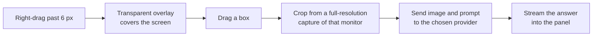

<div align="center">


### Right-click and drag over anything. Get an answer right where you are looking.

[](https://github.com/NarihitoM/AutoDesk/actions/workflows/ci.yml)


[](https://github.com/NarihitoM/AutoDesk/releases/latest)

[Features](#features) &nbsp;&bull;&nbsp; [Install](#install) &nbsp;&bull;&nbsp; [Getting started](#getting-started) &nbsp;&bull;&nbsp; [Privacy](#privacy) &nbsp;&bull;&nbsp; [Development](#development)

</div>

<br />

AutoDesk is a lightweight Windows tray app that turns any part of your screen into an AI prompt. Point it at an error message, a chart, a math problem, a form, or a page in another language. Drag a box over it, let go, and the answer streams into a small panel right next to your selection. No copying, no pasting, no switching windows.

## Features

<table>
  <tr>
    <td width="50%" valign="top">
      <h4>Right-click and drag to capture</h4>
      Hold the right mouse button, drag a box, and let go. That is the whole workflow. No screenshot tool, no file to save, no window to switch to.
    </td>
    <td width="50%" valign="top">
      <h4>Your right-click keeps working</h4>
      A quick right-click still opens menus as usual. Only a right-drag starts a capture, and you can switch to Alt, Ctrl, or Shift + drag instead.
    </td>
  </tr>
  <tr>
    <td width="50%" valign="top">
      <h4>Answers next to what you selected</h4>
      Replies stream in as they are written, with Markdown formatting and code blocks. Ask follow-up questions about the same capture.
    </td>
    <td width="50%" valign="top">
      <h4>Your choice of AI</h4>
      OpenAI, Claude, Gemini, Groq, OpenRouter, or a free local model through Ollama or LM Studio. The model list loads live and shows only models that can read images.
    </td>
  </tr>
  <tr>
    <td width="50%" valign="top">
      <h4>Sharp on any screen</h4>
      Works across multiple monitors and high-DPI displays, and captures at full resolution.
    </td>
    <td width="50%" valign="top">
      <h4>Private by design</h4>
      No AutoDesk server, no account. Your API keys are encrypted on your PC, and images go straight to the provider you chose.
    </td>
  </tr>
</table>

## Install

1. Download **`AutoDesk Setup x.y.z.exe`** from the [latest release](https://github.com/NarihitoM/AutoDesk/releases/latest).
2. Run the installer.
3. AutoDesk starts in the system tray. The Settings window opens the first time so you can add a key.

> [!NOTE]
> The installer is not code-signed yet, so Windows SmartScreen may show a warning. Click **More info**, then **Run anyway**.

## Getting started

**1. Connect an AI provider**

| Provider | Where to get a key | Needs a key |
| --- | --- | :---: |
| OpenAI | [platform.openai.com/api-keys](https://platform.openai.com/api-keys) | Yes |
| Anthropic Claude | [console.anthropic.com/settings/keys](https://console.anthropic.com/settings/keys) | Yes |
| Google Gemini | [aistudio.google.com/apikey](https://aistudio.google.com/apikey) | Yes |
| Groq | [console.groq.com/keys](https://console.groq.com/keys) | Yes |
| OpenRouter | [openrouter.ai/keys](https://openrouter.ai/keys) | Yes |
| Ollama (local, free) | Install [Ollama](https://ollama.com), then run `ollama pull llava` | No |
| LM Studio (local, free) | Install [LM Studio](https://lmstudio.ai), load a vision model, and start the local server | No |
| Custom | Any server with an OpenAI-compatible API | Optional |

Open **Settings** from the tray icon, pick the provider, paste the key, and choose a model. The model list is fetched live from the provider and filtered to models that accept images. Click **Save** when you are done.

**2. Capture**

Hold the **right mouse button**, drag over part of your screen, and let go. The answer appears in a panel next to your selection.

### Controls

| Action | How |
| --- | --- |
| Capture an area | Hold the right mouse button and drag |
| Open a normal context menu | Right-click without dragging |
| Cancel a capture | <kbd>Esc</kbd> while dragging, or drag a box smaller than 8 px |
| Ask a follow-up | Type in the panel and press <kbd>Enter</kbd> (<kbd>Shift</kbd>+<kbd>Enter</kbd> adds a new line) |
| Stop a reply | Click **Stop** |
| Close the panel | <kbd>Esc</kbd> or **Close** |
| Pause, Settings, Quit | Right-click the tray icon |

### Settings

| Setting | What it does |
| --- | --- |
| AI provider | Which service answers your captures |
| API key | Your key for that provider. Optional for local servers. |
| Model | A dropdown of the provider's live model list, showing only models that accept images. Before a key is added, it shows suggested models. |
| Base URL | Change only for a proxy or a self-hosted server |
| Capture key | Right mouse button (default), or hold <kbd>Alt</kbd>, <kbd>Ctrl</kbd>, or <kbd>Shift</kbd> and left-drag |
| Prompt | The instruction sent with every capture |
| Start with Windows | Launch AutoDesk when you sign in |

<details>
<summary><b>Default models and endpoints</b></summary>
<br />

| Provider | Model | Base URL |
| --- | --- | --- |
| OpenAI | `gpt-5` | `https://api.openai.com/v1` |
| Anthropic | `claude-opus-5-5` | `https://api.anthropic.com` |
| Gemini | `gemini-2.5-flash` | `https://generativelanguage.googleapis.com` |
| Groq | `meta-llama/llama-4-scout-17b-16e-instruct` | `https://api.groq.com/openai/v1` |
| OpenRouter | `google/gemini-2.5-flash` | `https://openrouter.ai/api/v1` |
| Ollama | `llava` | `http://localhost:11434/v1` |
| LM Studio | `qwen2.5-vl-7b-instruct` | `http://localhost:1234/v1` |
| Custom | `llava` | `http://localhost:8000/v1` |

</details>

<details>
<summary><b>How the model list knows which models accept images</b></summary>
<br />

| Provider | Source of the list | How image support is detected |
| --- | --- | --- |
| Anthropic | Models API | The `image_input` capability reported for each model |
| OpenRouter | Models API | The model's `input_modalities` include `image` |
| Ollama | `/api/tags` and `/api/show` | The model's capabilities include `vision` |
| LM Studio | `/api/v0/models` | The model type is `vlm` |
| OpenAI, Gemini | Models API | Matched by model family, since these APIs do not report image support |
| Groq, Custom | `/models` | Matched by model name. If nothing matches, every model is shown. |

</details>

## Privacy

- A screenshot is taken only when you finish a drag, and only of the area you selected.
- The image and your questions go directly from your PC to the provider you chose. There is no AutoDesk server in between.
- Everything is stored locally in a `.autodesk` folder in your user profile, created the first time you open the app:

  ```
  C:\Users\<you>\.autodesk\
    settings.json       provider, models, prompt, capture key
    credentials.json    API keys, encrypted for your Windows account
  ```

- API keys are encrypted with Windows' built-in data protection, so the file cannot be read on another PC or by another Windows user. If you paste a plain key into `credentials.json` by hand, AutoDesk encrypts it the next time it starts.
- Click **Open folder** in Settings to jump to this folder.

## Development

**Requirements:** Windows 10 or 11, Node.js 22.12 or newer.

```bash
npm install
npm run dev          # run the app with hot reload
npm test             # unit tests
npm run test:watch   # unit tests in watch mode
npm run typecheck    # TypeScript checks
npm run dist         # build the installer into dist/
```

**Tech stack:** Electron, React, TypeScript, Vite (electron-vite), Zustand, `uiohook-napi` to detect the capture key globally, and `koffi` for the Windows mouse hook behind right-drag capture.

<details>
<summary><b>How capture works</b></summary>
<br />



1. A low-level Windows mouse hook, running on its own thread, holds back the right button press. If you release without moving, it replays a normal right-click, so context menus still open. If you move more than 6 px, a capture starts and the app underneath never sees the click.
2. A transparent overlay window covers the screen under the cursor and draws the selection as you drag.
3. With Alt, Ctrl, or Shift as the capture key, a global keyboard hook arms the overlay after the key is held on its own for 150 ms, and you left-drag on the overlay instead.
4. On release, the selected area is cropped from a full-resolution capture of that monitor. The overlay is excluded from the capture.
5. The image is sent with your prompt to the provider, and the reply streams into the panel.

</details>

<details>
<summary><b>Project structure</b></summary>
<br />

```
electron/
  main.ts            app startup, tray, and wiring
  preload.ts         safe API exposed to the windows
  Agent/             providers (OpenAI, Anthropic, Gemini), streaming, chat session
  Ipc/               IPC handlers for capture, AI, and settings
  settings/          settings storage, defaults, and input checking
  tools/             capture key logic, screen capture, windows, tray
src/
  features/
    capture-overlay/ the selection overlay
    response-panel/  the answer panel
    settings/        the settings window
  shared/            types, helpers, and assets shared across the app
  pages/             one thin page per window
resources/icon.png   app and tray icon
```

</details>

<details>
<summary><b>Continuous integration and releases</b></summary>
<br />

Every push to `main` and every pull request runs three jobs: typecheck, unit tests, and build. Test failures appear as annotations on the failing lines, and a JUnit report is attached to each run.

To publish a new installer, push a version tag:

```bash
git tag v0.2.0
git push origin v0.2.0
```

The Release workflow sets the app version from the tag, runs the checks, builds `AutoDesk Setup 0.2.0.exe`, and attaches it to a new GitHub Release with generated notes.

</details>

### Troubleshooting

| Problem | Fix |
| --- | --- |
| `npm run dev` fails with `reading 'requestSingleInstanceLock'` | Your terminal has `ELECTRON_RUN_AS_NODE` set. Clear it with `Remove-Item Env:ELECTRON_RUN_AS_NODE` (PowerShell) or `unset ELECTRON_RUN_AS_NODE` (bash). |
| The panel says to add an API key | Open Settings from the tray icon, paste a key for the selected provider, and click Save. |
| A local model ignores the image | The model does not support images. Use a vision model such as `llava` or `qwen2.5vl`. |
| Right-drag does nothing | Check that capture is not paused in the tray menu, and that the capture key in Settings is Right mouse button. |
| A game or app needs right-drag | Choose **Pause capture** in the tray menu while you use it, or switch the capture key to Alt, Ctrl, or Shift. |
| The model list says it could not load models | Check the API key and base URL. For Ollama and LM Studio, make sure the app is running and its local server is started. Suggested models are shown until the list loads. |
