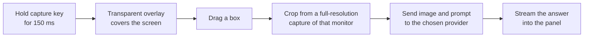

<div align="center">


### Hold Alt. Drag over anything. Get an answer right where you are looking.

[](https://github.com/NarihitoM/AutoDesk/actions/workflows/ci.yml)


[](https://github.com/NarihitoM/AutoDesk/releases/latest)

[Features](#features) &nbsp;&bull;&nbsp; [Install](#install) &nbsp;&bull;&nbsp; [Getting started](#getting-started) &nbsp;&bull;&nbsp; [Privacy](#privacy) &nbsp;&bull;&nbsp; [Development](#development)

</div>

<br />

AutoDesk is a lightweight Windows tray app that turns any part of your screen into an AI prompt. Point it at an error message, a chart, a math problem, a form, or a page in another language. Drag a box over it, let go, and the answer streams into a small panel right next to your selection. No copying, no pasting, no switching windows.

## Features

<table>
  <tr>
    <td width="50%" valign="top">
      <h4>Hold and drag to capture</h4>
      Hold the capture key, drag a box, and let go. That is the whole workflow. No screenshot tool, no file to save, no window to switch to.
    </td>
    <td width="50%" valign="top">
      <h4>Your shortcuts keep working</h4>
      Capture starts only when the key is held on its own. Alt+Tab and every other shortcut behave exactly as before.
    </td>
  </tr>
  <tr>
    <td width="50%" valign="top">
      <h4>Answers next to what you selected</h4>
      Replies stream in as they are written, with Markdown formatting and code blocks. Ask follow-up questions about the same capture.
    </td>
    <td width="50%" valign="top">
      <h4>Your choice of AI</h4>
      OpenAI, Anthropic Claude, Google Gemini, or a free local model through Ollama. LM Studio, OpenRouter, and Groq work too.
    </td>
  </tr>
  <tr>
    <td width="50%" valign="top">
      <h4>Sharp on any screen</h4>
      Works across multiple monitors and high-DPI displays, and captures at full resolution.
    </td>
    <td width="50%" valign="top">
      <h4>Private by design</h4>
      No AutoDesk server, no account. Your API keys are encrypted on your PC, and images go straight to the provider you chose.
    </td>
  </tr>
</table>

## Install

1. Download **`AutoDesk Setup x.y.z.exe`** from the [latest release](https://github.com/NarihitoM/AutoDesk/releases/latest).
2. Run the installer.
3. AutoDesk starts in the system tray. The Settings window opens the first time so you can add a key.

> [!NOTE]
> The installer is not code-signed yet, so Windows SmartScreen may show a warning. Click **More info**, then **Run anyway**.

## Getting started

**1. Connect an AI provider**

| Provider | Where to get a key | Needs a key |
| --- | --- | :---: |
| OpenAI | [platform.openai.com/api-keys](https://platform.openai.com/api-keys) | Yes |
| Anthropic Claude | [console.anthropic.com/settings/keys](https://console.anthropic.com/settings/keys) | Yes |
| Google Gemini | [aistudio.google.com/apikey](https://aistudio.google.com/apikey) | Yes |
| Ollama (local, free) | Install [Ollama](https://ollama.com), then run `ollama pull llava` | No |

Open **Settings** from the tray icon, pick the provider, paste the key, and click **Save**.

**2. Capture**

Hold **Alt**, drag over part of your screen, and let go. The answer appears in a panel next to your selection.

### Controls

| Action | How |
| --- | --- |
| Capture an area | Hold <kbd>Alt</kbd>, then left-click and drag |
| Cancel a capture | <kbd>Esc</kbd>, right-click, or release <kbd>Alt</kbd> before dragging |
| Ask a follow-up | Type in the panel and press <kbd>Enter</kbd> (<kbd>Shift</kbd>+<kbd>Enter</kbd> adds a new line) |
| Stop a reply | Click **Stop** |
| Close the panel | <kbd>Esc</kbd> or **Close** |
| Pause, Settings, Quit | Right-click the tray icon |

### Settings

| Setting | What it does |
| --- | --- |
| AI provider | Which service answers your captures |
| API key | Your key for that provider. Optional for local servers. |
| Model | Any model from that provider that can read images |
| Base URL | Change only for a proxy or a self-hosted server |
| Capture key | <kbd>Alt</kbd>, <kbd>Ctrl</kbd>, or <kbd>Shift</kbd> |
| Prompt | The instruction sent with every capture |
| Start with Windows | Launch AutoDesk when you sign in |

<details>
<summary><b>Default models and endpoints</b></summary>
<br />

| Provider | Model | Base URL |
| --- | --- | --- |
| OpenAI | `gpt-5` | `https://api.openai.com/v1` |
| Anthropic | `claude-opus-5-5` | `https://api.anthropic.com` |
| Gemini | `gemini-2.5-flash` | `https://generativelanguage.googleapis.com` |
| OpenAI-compatible | `llava` | `http://localhost:11434/v1` (Ollama) |

For LM Studio, use `http://localhost:1234/v1`. Pick a model that accepts images.

</details>

## Privacy

- A screenshot is taken only when you finish a drag, and only of the area you selected.
- The image and your questions go directly from your PC to the provider you chose. There is no AutoDesk server in between.
- Settings are stored in `%APPDATA%\AutoDesk\settings.json`. API keys in that file are encrypted with Windows' built-in data protection.

## Development

**Requirements:** Windows 10 or 11, Node.js 22.12 or newer.

```bash
npm install
npm run dev          # run the app with hot reload
npm test             # unit tests
npm run test:watch   # unit tests in watch mode
npm run typecheck    # TypeScript checks
npm run dist         # build the installer into dist/
```

**Tech stack:** Electron, React, TypeScript, Vite (electron-vite), Zustand, and `uiohook-napi` to detect the capture key globally.

<details>
<summary><b>How capture works</b></summary>
<br />



1. A global keyboard hook watches for the capture key being held on its own for 150 ms. Pressing any other key, or clicking first, cancels it.
2. A transparent overlay window covers the screen under the cursor, so your drag goes to the overlay and never to the app underneath.
3. On release, the selected area is cropped from a full-resolution capture of that monitor. The overlay is excluded from the capture.
4. The image is sent with your prompt to the provider, and the reply streams into the panel.

</details>

<details>
<summary><b>Project structure</b></summary>
<br />

```
electron/
  main.ts            app startup, tray, and wiring
  preload.ts         safe API exposed to the windows
  Agent/             providers (OpenAI, Anthropic, Gemini), streaming, chat session
  Ipc/               IPC handlers for capture, AI, and settings
  settings/          settings storage, defaults, and input checking
  tools/             capture key logic, screen capture, windows, tray
src/
  features/
    capture-overlay/ the selection overlay
    response-panel/  the answer panel
    settings/        the settings window
  shared/            types, helpers, and assets shared across the app
  pages/             one thin page per window
resources/icon.png   app and tray icon
```

</details>

<details>
<summary><b>Continuous integration and releases</b></summary>
<br />

Every push to `main` and every pull request runs three jobs: typecheck, unit tests, and build. Test failures appear as annotations on the failing lines, and a JUnit report is attached to each run.

To publish a new installer, push a version tag:

```bash
git tag v0.2.0
git push origin v0.2.0
```

The Release workflow sets the app version from the tag, runs the checks, builds `AutoDesk Setup 0.2.0.exe`, and attaches it to a new GitHub Release with generated notes.

</details>

### Troubleshooting

| Problem | Fix |
| --- | --- |
| `npm run dev` fails with `reading 'requestSingleInstanceLock'` | Your terminal has `ELECTRON_RUN_AS_NODE` set. Clear it with `Remove-Item Env:ELECTRON_RUN_AS_NODE` (PowerShell) or `unset ELECTRON_RUN_AS_NODE` (bash). |
| The panel says to add an API key | Open Settings from the tray icon, paste a key for the selected provider, and click Save. |
| A local model ignores the image | The model does not support images. Use a vision model such as `llava` or `qwen2.5vl`. |
| Holding Alt does nothing | Check that capture is not paused in the tray menu, and that the capture key in Settings is Alt. |
